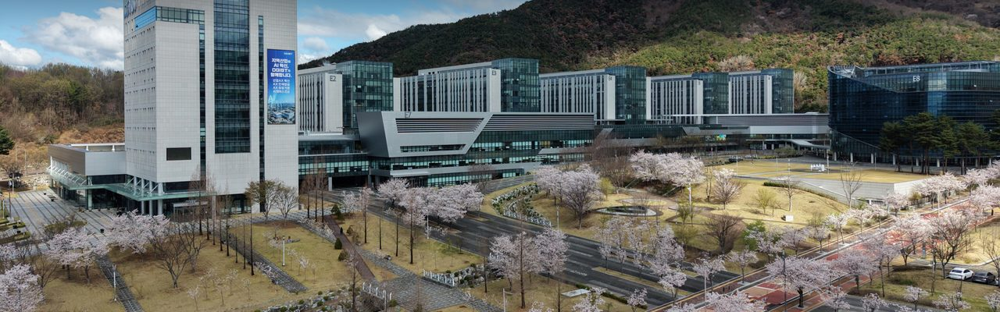

  

<h1 align="center">Hyeonjae Jeon, Ph.D. (전현재)</h1>

  Postdoctoral researcher at DGIST, InnoCORE Emergent Intelligence Physical AI Research Center 
  Vision-language-action models for humanoid robots, and perception that holds up in rain, darkness and blur

  
  
  
  

## About

I work on robots and vehicles that keep working when conditions stop cooperating. My current research is on
vision-language-action (VLA) models: how to post-train them so they stay reliable outside their demonstrations,
and how to bring them onto humanoid and dual-arm robots.

I received my Ph.D. from DGIST in 2026 for work on autonomous driving in adverse weather: measuring how far
perception degrades when the camera is blocked by rain, generating realistic rainy data to train on, and
restoring images before perception runs.

## What I work on

- **Vision-language-action models** for humanoid and dual-arm robots, from post-training to real-world deployment
- **Robustness outside the training data**: out-of-distribution robot states, occlusion, adverse weather, blur and low light
- **Data generation and restoration**: image-to-image translation and diffusion-based image restoration
- **Autonomous driving and mobile robots**: lane detection, path tracking and ROS-based systems on real platforms

## Selected publications

| Year | Paper | Venue |
|---|---|---|
| 2025 | [RainSD: Rain Style Diversification Module for Image Synthesis Enhancement Using Feature-Level Style Distribution](https://arxiv.org/abs/2401.00460) | Robotics and Autonomous Systems |
| 2024 | BEV Image-based Lane Tracking Control System for Autonomous Lane Repainting Robot (co-first author) | IROS |
| 2024 | LuminanceGAN: Controlling the Brightness of Generated Images for Various Night Conditions | Pattern Recognition Letters |
| 2023 | [Horizontal Attention Based Generation Module for Unsupervised Domain Adaptive Stereo Matching](https://doi.org/10.1109/LRA.2023.3313009) | IEEE RA-L |
| 2022 | [CARLA Simulator-Based Evaluation Framework Development of Lane Detection Accuracy Performance Under Sensor Blockage Caused by Heavy Rain for Autonomous Vehicle](https://doi.org/10.1109/LRA.2022.3192632) | IEEE RA-L |

The full list, research projects and background are on [my homepage](https://wjsguswo.github.io).

## Tools

  
  
  
  
  
  
  
  

